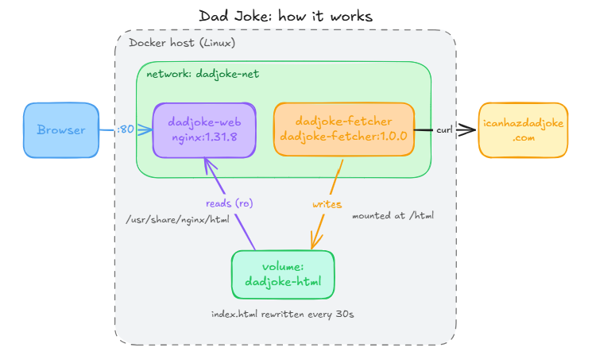

# Dad Joke App: From Docker Commands to Docker Compose

A small two-container app that fetches a random dad joke every 30 seconds and serves it on a web page. The app is deliberately simple, because it isn't the point. The point is **how it's run**. The same app is run two ways: by hand with individual `docker` commands, and declaratively with Docker Compose. Side by side, they show exactly what Compose takes off your plate.

## The App



* **fetcher**: an Alpine container that polls [icanhazdadjoke.com](https://icanhazdadjoke.com/) every 30 seconds and writes the joke to a shared volume as `index.html`.
* **web**: nginx, serving that `index.html` on port 80.

Two containers, one shared volume, one network. Even something this small takes several steps to run, and they all have to be right, in the right order, every time.

## The Problem With Manual Commands

Starting the app by hand takes five commands:

```shell
## Assumes starting in 01-manual/
docker build -t dadjoke-fetcher:1.0.0 ../app
docker network create dadjoke-net
docker volume create dadjoke-html
docker run -d --name dadjoke-fetcher --network dadjoke-net -v dadjoke-html:/html dadjoke-fetcher:1.0.0
docker run -d --name dadjoke-web --network dadjoke-net -p 80:80 -v dadjoke-html:/usr/share/nginx/html:ro nginx:1.31.8
```

Stopping it cleanly takes three more:

```shell
docker rm -f dadjoke-fetcher dadjoke-web
docker network rm dadjoke-net
docker volume rm dadjoke-html
```

Running it this way leaves you responsible for all of it:

* **Order**: the image has to be built, and the network and volume created, before either container starts.
* **Names**: `dadjoke-net`, `dadjoke-html`, `dadjoke-fetcher` and `dadjoke-web` have to match exactly between starting and stopping. Mistype one and something fails or gets left behind.
* **Cleanup**: miss a step and orphaned containers, networks or volumes pile up in `docker ps -a`, `docker network ls` and `docker volume ls`.
* **Recovery**: there's no restart policy. If a container stops, it stays stopped until you notice.
* **Documentation**: the only description of the app is a set of shell commands.

## How Compose Fixes It

`docker compose` replaces all of that with one declarative file, [`02-compose/compose.yaml`](02-compose/compose.yaml). It describes the two services, the shared volume, the build context and a restart policy. Compose works out the rest:

* **Order**: it builds the fetcher image, creates the volume, and starts `fetcher` before `web` (`depends_on`).
* **Networking**: the network isn't declared at all. Compose creates a default network for the project (`dadjoke_default`) and attaches both services automatically.
* **Names**: everything is named consistently from the project name: `dadjoke-fetcher-1`, `dadjoke-web-1`, `dadjoke_html`, `dadjoke_default`.
* **Cleanup**: `down -v` removes everything `up` created, so there are no names to remember.
* **Recovery**: `restart: unless-stopped` brings a container back if it exits or Docker restarts, unless you stopped it yourself.

```shell
cd 02-compose
docker compose up -d --build   # build, create and start everything
docker compose down -v         # stop and remove containers, network and volume
```

That's two commands instead of eight, with no network or volume bookkeeping, and the whole app definition lives in Git where it can be reviewed and versioned.

## Try It Yourself

Requires Docker with the Compose plugin (`docker compose`), and port 80 free on your machine.

* [`01-manual/`](01-manual/README.md): the manual way, one `docker` command at a time.
* [`02-compose/`](02-compose/README.md): the same app, defined once in `compose.yaml`.
